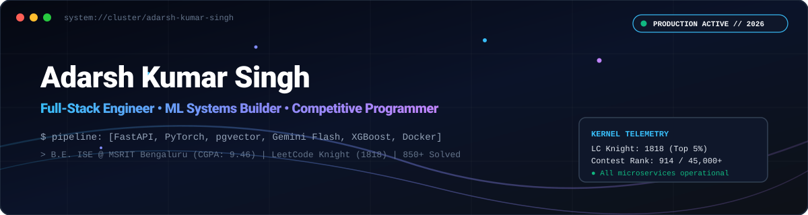
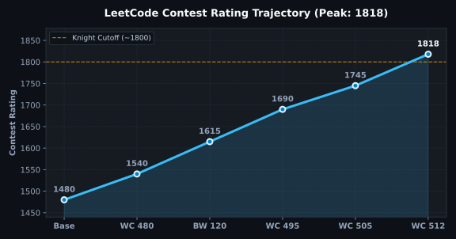
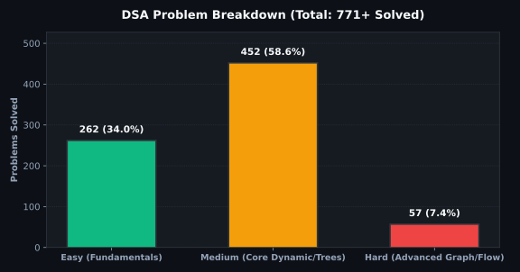
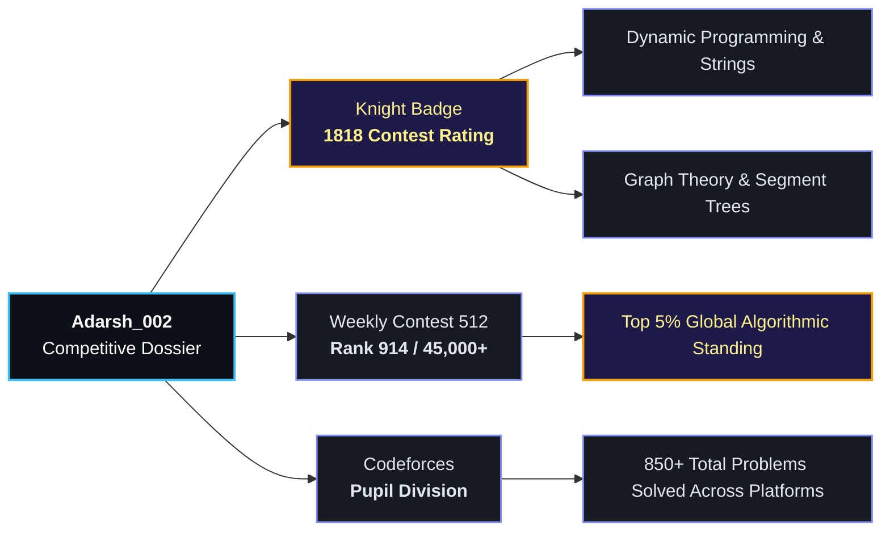

<!-- CUSTOM CSS KEYFRAME ANIMATED HERO BANNER -->

<!-- DYNAMIC TYPING SVG -->

  
  
  
  
  

---

### ⚡ Bento Grid // Executive Telemetry

<table width="100%" border="0" cellspacing="0" cellpadding="0">
  <tr valign="top">
    <!-- LEFT PANE: GITHUB TELEMETRY -->
    <td width="50%" align="center">
      <picture>
        <source media="(prefers-color-scheme: dark)" srcset="https://github-readme-stats.vercel.app/api?username=adarshsingh002&show_icons=true&theme=tokyonight&hide_border=true&bg_color=0d1117&title_color=38bdf8&icon_color=818cf8&text_color=94a3b8" />
        <source media="(prefers-color-scheme: light)" srcset="https://github-readme-stats.vercel.app/api?username=adarshsingh002&show_icons=true&theme=default&hide_border=true" />
        
      </picture>
        
      <picture>
        <source media="(prefers-color-scheme: dark)" srcset="https://github-readme-streak-stats.herokuapp.com/?user=adarshsingh002&theme=tokyonight&hide_border=true&background=0d1117&ring=38bdf8&fire=f59e0b&currStreakNum=38bdf8" />
        <source media="(prefers-color-scheme: light)" srcset="https://github-readme-streak-stats.herokuapp.com/?user=adarshsingh002&theme=default&hide_border=true" />
        
      </picture>
    </td>
    <!-- RIGHT PANE: ALGORITHMIC MASTERY & LANGUAGE MATRIX -->
    <td width="50%" align="center">
      
        
      <picture>
        <source media="(prefers-color-scheme: dark)" srcset="https://github-readme-stats.vercel.app/api/top-langs/?username=adarshsingh002&layout=compact&theme=tokyonight&hide_border=true&bg_color=0d1117&title_color=38bdf8&text_color=94a3b8" />
        <source media="(prefers-color-scheme: light)" srcset="https://github-readme-stats.vercel.app/api/top-langs/?username=adarshsingh002&layout=compact&theme=default&hide_border=true" />
        
      </picture>
    </td>
  </tr>
</table>

---

### ⌨️ Terminal Keycap Tech Stack

> *Keyboard switch layout with direct jump links to runtime implementations.*

| Domain | Keyboard Switches (`<kbd>`) | Linked Runtime |
| :--- | :--- | :--- |
| **Languages & Systems** | <a href="#project-wealthpilot"><kbd>🐍 Python</kbd></a> <a href="#project-finsocial"><kbd>☕ Java</kbd></a> <a href="#project-finsocial"><kbd>⚡ C</kbd></a> <a href="#project-finsocial"><kbd>🗄️ SQL</kbd></a> | [WealthPilot-AI](#project-wealthpilot) • [FinSocial](#project-finsocial) |
| **Backend & Microservices** | <a href="#project-wealthpilot"><kbd>⚡ FastAPI</kbd></a> <a href="#project-finsocial"><kbd>🟢 Node.js</kbd></a> <a href="#project-finsocial"><kbd>🚂 Express.js</kbd></a> <a href="#project-triageai"><kbd>🛡️ Pydantic</kbd></a> | [WealthPilot-AI](#project-wealthpilot) • [FinSocial](#project-finsocial) • [TriageAI](#project-triageai) |
| **Machine Learning & AI** | <a href="#project-finsocial"><kbd>🔥 PyTorch</kbd></a> <a href="#project-finsocial"><kbd>🌲 XGBoost</kbd></a> <a href="#project-finsocial"><kbd>📈 FinBERT</kbd></a> <a href="#project-triageai"><kbd>✨ Gemini API</kbd></a> <a href="#project-triageai"><kbd>🎙️ Whisper</kbd></a> | [FinSocial](#project-finsocial) • [TriageAI](#project-triageai) |
| **Databases, Vectors & Cache** | <a href="#project-finsocial"><kbd>🐘 PostgreSQL</kbd></a> <a href="#project-finsocial"><kbd>📐 pgvector</kbd></a> <a href="#project-finsocial"><kbd>🍃 MongoDB</kbd></a> <a href="#project-finsocial"><kbd>⚡ Redis</kbd></a> | [FinSocial](#project-finsocial) • [TriageAI](#project-triageai) |
| **DevOps & Real-Time** | <a href="#project-triageai"><kbd>🐳 Docker</kbd></a> <a href="#project-finsocial"><kbd>🔌 WebSockets</kbd></a> | [FinSocial](#project-finsocial) • [TriageAI](#project-triageai) |

---

### 🧠 Algorithmic Telemetry & Custom Vector Visuals

<table width="100%" border="0" cellspacing="0" cellpadding="0">
  <tr valign="top">
    <td width="50%" align="center">
      
    </td>
    <td width="50%" align="center">
      
    </td>
  </tr>
</table>

---

### 💻 Production Deployments // macOS Runtime Windows

<!-- MAC WINDOW 1: FINSOCIAL -->

<table width="100%" cellspacing="0" cellpadding="0" style="border: 1px solid #30363d; border-radius: 10px; overflow: hidden; background-color: #0d1117;">
  <tr>
    <td bgcolor="#161b22" style="padding: 10px 14px; border-bottom: 1px solid #30363d;">
      ●&nbsp;
      ●&nbsp;
      ●&nbsp;&nbsp;
      <code style="color: #8b949e; font-family: 'Fira Code', monospace; font-size: 12px;">adarsh@mbp: ~/systems/finsocial (production-cluster)</code>
    </td>
  </tr>
  <tr>
    <td bgcolor="#0d1117" style="padding: 16px 20px;">
      <pre style="margin: 0; font-family: 'Fira Code', monospace; font-size: 13px; line-height: 1.6; color: #c9d1d9;">
➜ finsocial --telemetry --symbols=NSE,BSE --mode=live-rag

✔ [GATEWAY] Bidirectional WebSocket stream established (sub-50ms latency)
✔ [PREDICT] XGBoost directional classifier loaded (10Y OHLCV feature set)
✔ [NLP-ENG] FinBERT sentiment inference worker active on financial news feeds
✔ [VEC-DB ] In-database pgvector assistant initialized for corporate disclosures
▶ [STATUS ] Real-time paper trading engine executing concurrent tick orders
      </pre>
      

        <kbd>🐍 Python</kbd>&nbsp;
        <kbd>🟢 Node.js</kbd>&nbsp;
        <kbd>🚂 Express.js</kbd>&nbsp;
        <kbd>🌲 XGBoost</kbd>&nbsp;
        <kbd>📈 FinBERT</kbd>&nbsp;
        <kbd>📐 pgvector</kbd>&nbsp;
        <kbd>⚡ Redis</kbd>&nbsp;
        <kbd>🔌 WebSockets</kbd>
      

    </td>
  </tr>
</table>

 

<!-- MAC WINDOW 2: TRIAGEAI -->

<table width="100%" cellspacing="0" cellpadding="0" style="border: 1px solid #30363d; border-radius: 10px; overflow: hidden; background-color: #0d1117;">
  <tr>
    <td bgcolor="#161b22" style="padding: 10px 14px; border-bottom: 1px solid #30363d;">
      ●&nbsp;
      ●&nbsp;
      ●&nbsp;&nbsp;
      <code style="color: #8b949e; font-family: 'Fira Code', monospace; font-size: 12px;">adarsh@mbp: ~/services/triage-ai (k8s-mesh)</code>
    </td>
  </tr>
  <tr>
    <td bgcolor="#0d1117" style="padding: 16px 20px;">
      <pre style="margin: 0; font-family: 'Fira Code', monospace; font-size: 13px; line-height: 1.6; color: #c9d1d9;">
➜ triage-ai --pipeline=multimodal-hybrid --validation=strict

✔ [PERCEIVE] Audio stream transcribed via Whisper engine with timestamp sync
✔ [OCR-ENG ] Tesseract OCR text extraction verified across incident scans
✔ [SCHEMA  ] Zero-drift Pydantic validation filters enforced at ingress
✔ [HYBRID  ] Dual-layer RAG (Dense embeddings + Sparse tokens) synchronized
▶ [ROUTING ] Gemini Flash classifying critical priority paths under 650ms
      </pre>
      

        <kbd>⚡ FastAPI</kbd>&nbsp;
        <kbd>✨ Gemini Flash</kbd>&nbsp;
        <kbd>🎙️ Whisper</kbd>&nbsp;
        <kbd>🔍 Tesseract OCR</kbd>&nbsp;
        <kbd>🛡️ Pydantic</kbd>&nbsp;
        <kbd>🐳 Docker</kbd>
      

    </td>
  </tr>
</table>

 

<!-- MAC WINDOW 3: WEALTHPILOT-AI -->

<table width="100%" cellspacing="0" cellpadding="0" style="border: 1px solid #30363d; border-radius: 10px; overflow: hidden; background-color: #0d1117;">
  <tr>
    <td bgcolor="#161b22" style="padding: 10px 14px; border-bottom: 1px solid #30363d;">
      ●&nbsp;
      ●&nbsp;
      ●&nbsp;&nbsp;
      <code style="color: #8b949e; font-family: 'Fira Code', monospace; font-size: 12px;">adarsh@mbp: ~/quant/wealthpilot-ai (fastapi-worker)</code>
    </td>
  </tr>
  <tr>
    <td bgcolor="#0d1117" style="padding: 16px 20px;">
      <pre style="margin: 0; font-family: 'Fira Code', monospace; font-size: 13px; line-height: 1.6; color: #c9d1d9;">
➜ wealthpilot --horizon=360m --rebalance=dynamic --detect-drift

✔ [MATH-CORE] 12-month exponential projection and decay matrices generated
✔ [SANDBOX  ] 360-month macro stress test executed across equity, gold & debt
✔ [MONITOR  ] Live variance drift detector hooked to asset weighting alerts
✔ [FASTAPI  ] Non-blocking endpoints delivering sub-15ms scenario recalculations
▶ [OPTIMIZE ] Rebalancing triggers automated via algorithmic risk targets
      </pre>
      

        <kbd>🐍 Python</kbd>&nbsp;
        <kbd>⚡ FastAPI</kbd>&nbsp;
        <kbd>📊 NumPy</kbd>&nbsp;
        <kbd>🧮 SciPy</kbd>&nbsp;
        <kbd>🐘 PostgreSQL</kbd>&nbsp;
        <kbd>🐳 Docker</kbd>
      

    </td>
  </tr>
</table>

---

<!-- ACHIEVEMENTS:START -->
### 🏆 Verified Honors & Continuous Integration Record

  
<b>🎯 Invitational Hackathons & Competitive Honors</b>

   
<table width="100%" cellspacing="0" cellpadding="6">
  <thead>
    <tr bgcolor="#161b22">
      <th align="left">Event</th>
      <th align="left">Organizer</th>
      <th align="left">Standing / Recognition</th>
      <th align="left">Domain Focus</th>
    </tr>
  </thead>
  <tbody>
  <tr>
    <td><b>Fidelity Investments India Hackathon 2026</b></td>
    <td>Fidelity Investments</td>
    <td><code style="color: #38bdf8;">National Finalist (Top 12 / 300+ Teams)</code></td>
    <td>Quant Systems & Financial Intelligence</td>
  </tr>
  <tr>
    <td><b>NER Tech Hackathon 2.0</b></td>
    <td>NERCOMS</td>
    <td><code style="color: #38bdf8;">Top 60 / 2,000+ Entries</code></td>
    <td>High-Scale Distributed Engineering</td>
  </tr>
  <tr>
    <td><b>Meta PyTorch OpenEnv Hackathon</b></td>
    <td>Meta / PyTorch</td>
    <td><code style="color: #38bdf8;">Recognized Contributor</code></td>
    <td>Multimodal Incident Triage & RL Envs</td>
  </tr>
  <tr>
    <td><b>CodeCrafter 2026</b></td>
    <td>MSRIT</td>
    <td><code style="color: #38bdf8;">Grand Finalist</code></td>
    <td>Full-Stack Microservices Architecture</td>
  </tr>
  <tr>
    <td><b>24-Hour Whackiest Flagship Hackathon</b></td>
    <td>MSRIT</td>
    <td><code style="color: #38bdf8;">Top 25 Placement</code></td>
    <td>Real-Time Resilient Systems</td>
  </tr>
  </tbody>
</table>

  
<b>📜 Academic Standing & Specializations</b>

   

- **B.E. in Information Science & Engineering:** M.S. Ramaiah Institute of Technology (MSRIT), Bengaluru — **CGPA: 9.46**
- **Retrieval Augmented Generation (RAG) Specialization** — *DeepLearning.AI* (2024)
- **Machine Learning Specialization** — *DeepLearning.AI & Stanford Online (Andrew Ng)* (2024)
- **AI & Machine Learning Workshop** — *Indian Institute of Science (IISc), Bengaluru* (2024)
- **Data Structures & Algorithms + Python Masterclass** — *Udemy* (2023)

  
<b>⚡ Live Competitive Stats (Synced via GitHub Actions)</b>

   

| Platform | Rating / Division | Global Placement | Total Volume |
| :--- | :--- | :--- | :--- |
| **LeetCode** (`Adarsh_002`) | <kbd>Knight: 1818</kbd> | **914 / 45,000+ (Weekly Contest 512)** | **855+ Solved** |
| **Codeforces** (`Adarsh_002`) | <kbd>Pupil: 1285</kbd> | **Max Rating: 1340** | Active Competitor |

<!-- ACHIEVEMENTS:END -->

---

### 👾 Contribution Activity Matrix

<picture>
  <source media="(prefers-color-scheme: dark)" srcset="./assets/github-snake-dark.svg" />
  <source media="(prefers-color-scheme: light)" srcset="https://raw.githubusercontent.com/adarshsingh002/adarshsingh002/output/github-contribution-grid-snake.svg" />
  
</picture>

  Autonomous profile telemetry powered by Python & GitHub Actions • © Adarsh Kumar Singh

